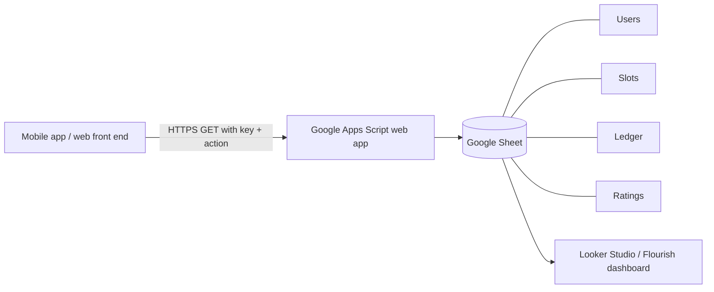

<div align="center">

# ⏱ SkillSwap

### Teach what you know, learn what you need · time credits, not money

A peer-to-peer skill exchange app for University of Hyderabad students.


</div>

---

## 🔗 Quick links

| | |
|---|---|
| 📱 **Download the APK** | [Download SkillSwap APK (Google Drive)](https://drive.google.com/file/d/1KI6j9X1L5a5VaoKnYEidP_JKIVD-lRLX/view?usp=drivesdk) |
| 📊 **Flourish dashboard** | [ADD FLOURISH STORY LINK] |
| 📄 **Privacy & Safety Policy** | [`docs/SkillSwap_Privacy_and_Safety_Policy.pdf`](docs/SkillSwap_Privacy_and_Safety_Policy.pdf) |
| 🖼 **A3 poster** | [`docs/SkillSwap_A3_Poster.pdf`](docs/SkillSwap_A3_Poster.pdf) |

> **Try it on your Android phone:** scan the QR code to download the APK, or [use this link](https://drive.google.com/file/d/1KI6j9X1L5a5VaoKnYEidP_JKIVD-lRLX/view?usp=drivesdk). You may need to allow installs from this source.

<div align="center">

</div>

---

## 📌 The problem

Many students are good at one thing (Python, LaTeX, Figma, Excel, spoken English) and stuck on another. Finding a peer to learn from is hard, and paid tutoring is expensive. Online videos are plentiful but cluttered, with no one to ask.

## 💡 Our solution

SkillSwap lets students **list skills they can teach and want to learn**. Tutors publish session slots, learners book them with **time credits (1 hour = 1 credit)**, both sides confirm after the session, and the credit moves from learner to tutor safely on the server.

## 👥 Who is it for?

- **Learners:** students who want to pick up a skill from a peer at no cost.
- **Tutors:** students who can teach something and want to earn credits to learn something else.
- **Campus community:** a shared pool of skills, shown on a dashboard of what is most wanted and offered.

---

## ✨ Features (MVP)

| Feature | What it does |
|---|---|
| **Sign up with university email** | Registration with a university email (`@uohyd.ac.in`). New users start with **2 credits**. |
| **Profile: offers and wants** | Comma-separated skills you can teach and want to learn, plus a nickname. |
| **Tutor slots** | A tutor publishes a slot: skill, date, time and a public campus place or online link. |
| **Search by skill** | Shows open, future slots that match a skill and are not your own. |
| **Booking with credit check** | Needs at least 1 available credit (credits minus pending bookings). |
| **Cancel** | Allowed up to 2 hours before the session starts. |
| **Two-sided confirmation** | Tutor and learner both confirm; only then does 1 credit move. |
| **Ratings** | Learners rate a session after it is confirmed. |
| **Credit ledger** | Every credit transfer is recorded as a row. |
| **Suggested matches** | Matches your wants with other students' offers. |
| **Dashboard** | Most-wanted skills and sessions per week. |

## 🖼 Screenshots

| Login | Profile and suggested match | My sessions | Insights (Flourish) |
|:---:|:---:|:---:|:---:|
|  |  |  |  |
| Sign in with a university email and a nickname | Skills to teach and learn, credits, suggested match | Booked and open sessions, as tutor or learner | Offers vs requests by category |

---:|:---:|:---:|:---:|
|  |  |  |  |

| Flourish dashboard |
|:---:|
|  |

> Replace the images above with real screenshots of the running app (3 to 5 is enough).

---

## 🔄 How it works

1. **Set up profile:** sign in with your university email and list skills you offer and want.
2. **Publish a slot:** the tutor adds skill, date, time and a campus place or online link.
3. **Search and book:** the learner searches by skill and books for 1 credit.
4. **Both confirm:** after the session, tutor and learner each confirm. 1 credit moves once.
5. **Rate:** the learner rates the session.

### Credit rules

- Credits are **not real money**. No payments and no paid tutoring.
- Credit changes happen **only on the server**, inside a lock, and every change has a **Ledger** row.
- A confirmed session cannot be confirmed again, so a credit is never transferred twice.

---

## 🏗 Architecture



The app calls one Apps Script web app with an `action` and its parameters. The script reads and writes the Sheet, and `LockService` prevents conflicting credit transfers.

### Data model (Google Sheet tabs)

| Tab | Columns (row 1) |
|---|---|
| **Users** | `email` · `nick` · `offers` · `wants` · `credits` |
| **Slots** | `slotId` · `tutor` · `skill` · `date` · `time` · `place` · `status` · `learner` · `tutorOk` · `learnerOk` |
| **Ledger** | `time` · `from` · `to` · `credits` · `slotId` |
| **Ratings** | `slotId` · `from` · `stars` · `time` |

`status` is one of `open`, `booked`, `done`, `cancelled`. Format the Slots `date` (`yyyy-MM-dd`) and `time` (`HH:mm`) columns as **Plain text**.

### API (Apps Script web app)

Every request is `…/exec?key=<KEY>&action=<action>&…`. Every reply is `{ "action": "...", "data": ... }`.

| action | Extra parameters | Returns |
|---|---|---|
| `login` | `email`, `nick` | `{credits}` |
| `profile` | `email`, `offers`, `wants` | `{ok}` |
| `search` | `email`, `skill` | open future slots |
| `publish` | `email`, `skill`, `date`, `time`, `place` | `{slotId}` |
| `book` | `email`, `slot` | `{ok}` or `{error}` |
| `cancel` | `email`, `slot` | `{ok}` |
| `confirm` | `email`, `slot` | `{ok, transferred}` |
| `mine` | `email` | my slots as tutor or learner, plus credits |
| `rate` | `email`, `slot`, `stars` | `{ok}` |

---

## 🧰 Tools used

| Area | Tool |
|---|---|
| Design | Figma |
| Front end | MIT App Inventor (Android APK) |
| Backend | Google Apps Script web app |
| Database | Google Sheets (Users, Slots, Ledger, Ratings) |
| Concurrency | Apps Script `LockService` |
| Dashboard | Flourish (story with 3 layouts) and Looker Studio |

---

## 🚀 Setup (for developers)

### 1. Google Sheet
1. Create a Google Sheet with four tabs named exactly **Users**, **Slots**, **Ledger**, **Ratings**.
2. Put the column headings from the data model above in row 1 of each tab.

### 2. Apps Script backend
1. In the Sheet, open **Extensions → Apps Script**.
2. Paste the project code into `Code.gs` (helpers, `route`, `confirm`, `addCredits`, `setSlot`).
3. Set your own secret in `const KEY = '...'`. **Do not commit your real key to GitHub.**
4. **Deploy → New deployment → Web app**, *Execute as: Me*, *Who has access: Anyone*. Authorise and copy the `/exec` URL.
5. Test in a browser: `…/exec?key=<KEY>&action=login&email=you@uohyd.ac.in&nick=You`
6. After every code change: **Deploy → Manage deployments → Edit → New version**.

### 3. Front end
1. Put the `/exec` URL and the key in the app's `apiUrl` and `apiKey` settings.
2. Build the APK or publish the site, share it as "anyone with the link", and test it on two phones that are not the developer's.

> Remove test data from the Sheet before sharing the live link.

---

## ✅ Test plan

| # | Test | Expected |
|---|---|---|
| T1 | New user signs up | 2 credits |
| T2 | Book with 2 credits and 2 pending bookings | "Not enough credits" |
| T3 | Book your own slot | "Not possible now" |
| T4 | Cancel 3 h before start | Slot open again |
| T5 | Cancel 1 h before start | "Too late to cancel" |
| T6 | Only the learner confirms | No transfer yet |
| T7 | Both confirm | Learner −1, tutor +1, one Ledger row |
| T8 | Confirm again | "Not in booked state" (no double transfer) |

*Record results here:* `[ADD PASS / FAIL SUMMARY FROM YOUR TEST SHEET]`

---

## 🔒 Privacy, safety and academic integrity

- Registration uses a **university email**. Profiles show **nicknames and skills, not phone numbers**.
- Project data is stored in Google Sheets and handled by Google Apps Script. Only authorised team members should access it.
- Sessions take place in **public campus places or online** only. Report misconduct to the project team.
- **Learning only:** SkillSwap must not be used to do assignments, lab records or exams for others.
- **Security limits:** the shared key in the app only prevents casual misuse and can be found by unpacking the APK. No encryption or extra authentication has been added by the team, and SkillSwap is not claimed to be fully secure or certified. Never store passwords, ID numbers or others' phone numbers in the Sheet.

Read the full one-page policy: [`docs/SkillSwap_Privacy_and_Safety_Policy.pdf`](docs/SkillSwap_Privacy_and_Safety_Policy.pdf)

---

## 📊 Pilot

| Real users | Sessions confirmed by both sides | Average rating |
|:---:|:---:|:---:|
| `[__]` | `[__]` | `[__]` |

Feedback summary: `[ADD 2 to 3 LINES FROM YOUR FEEDBACK FORM]`

---

## 🧑‍💻 Team

**Team name:** `[ADD TEAM NAME]`  ·  **Faculty guide / TA:** `[ADD NAME]`

| Role | Member | Roll number | Responsibility |
|---|---|---|---|
| **R1** Team Lead and Product Owner | Taif Al Ghazali | 25MCCE36 | Plan, requirements, user interviews, credit and integrity rules, pitch |
| **R2** UI/UX Designer | Aryan Thakur | 25MCCE24 | Figma screens, colours, accessibility, app icon |
| **R3** App Developer | Prathipati Joshitha | 25MCCE31 | App blocks logic, search, booking, confirmations, APK builds |
| **R4** Backend and Data Engineer | Amit Kumar | 25ETIM42 | Google Sheet, Apps Script API, safe credit transfer, dashboard data |
| **R5** QA, Integration and Outreach | Aman Singh | 25ETIM59 | Test plan, bug list, user testing, pilot, demo video |

---|---|---|
| Prathipati Joshitha | 25MCCE31 | `[ADD ROLE]` |
| Taif Al Ghazali | 25MCCE36 | `[ADD ROLE]` |
| Amit Kumar | 25ETIM42 | `[ADD ROLE]` |
| Aman Singh | 25ETIM59 | `[ADD ROLE]` |
| `[5th member, if any]` | `[ROLL NO.]` | `[ADD ROLE]` |

Roles used in the course brief: Team Lead and Product Owner, UI/UX Designer, App Developer, Backend and Data Engineer, QA, Integration and Outreach.

---

## 🗺 Limitations and future work

- Sessions are arranged in person or online outside the app; there are no in-app video calls.
- No money, exam help or assignment help, by design.
- Security is basic (shared key only). A future version could add proper sign-in and per-user access checks.
- `[ADD ANY OTHER KNOWN LIMITATIONS OR NEXT STEPS]`

## 📁 Repository structure

```
SkillSwap/
├── README.md
├── backend/
│   └── Code.gs                  # Apps Script (remove your real KEY before committing)
├── app/
│   └── SkillSwap_Final.aia      # App Inventor project
├── docs/
│   ├── SkillSwap_Privacy_and_Safety_Policy.pdf
│   ├── SkillSwap_A3_Poster.pdf
│   └── screenshots/             # login.png, profile.png, sessions.png, insights.png, qr.png
└── data/
    └── sample_seed_data.csv     # optional: seed users and slots (no real personal data)
```

## 🙏 Acknowledgements

Built for **IE209 Skill Development**, Semester III, School of Computer and Information Sciences, University of Hyderabad. Thanks to our TAs, faculty guide and the students who piloted the app.

---

<div align="center">
<sub>SkillSwap · For learning only: never for assignments or exams.</sub>
</div>
